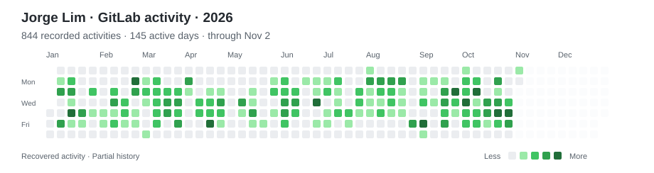
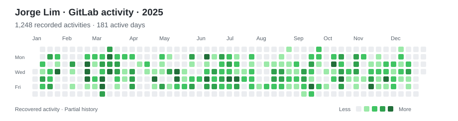
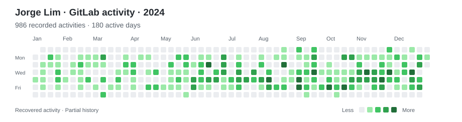
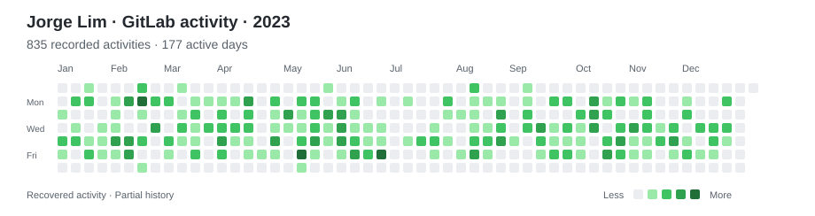
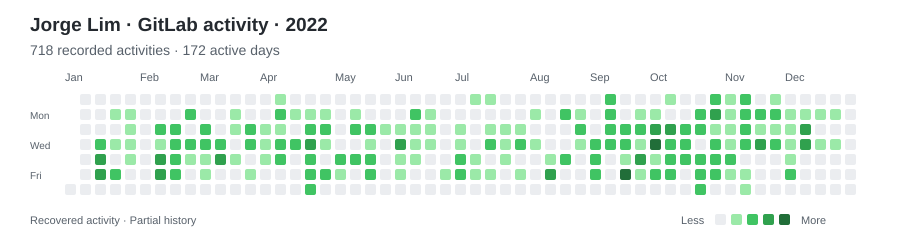

## Hi there 👋

<!--
**kimjo77/kimjo77** is a ✨ _special_ ✨ repository because its `README.md` (this file) appears on your GitHub profile.

Here are some ideas to get you started:

- 🔭 I’m currently working on ...
- 🌱 I’m currently learning ...
- 👯 I’m looking to collaborate on ...
- 🤔 I’m looking for help with ...
- 💬 Ask me about ...
- 📫 How to reach me: ...
- 😄 Pronouns: ...
- ⚡ Fun fact: ...
-->

## GitLab activity

Much of my professional development work lives in private
GitLab repositories. Here’s a recovered overview of my commits,
merge requests, reviews, and comments.

<picture>
  <source media="(prefers-color-scheme: dark)" srcset="assets/gitlab-2026-activity-dark.svg">
  <source media="(prefers-color-scheme: light)" srcset="assets/gitlab-2026-activity.svg">
  
</picture>

Previous years · 2022–2025

<picture>
  <source media="(prefers-color-scheme: dark)" srcset="assets/gitlab-2025-activity-dark.svg">
  <source media="(prefers-color-scheme: light)" srcset="assets/gitlab-2025-activity.svg">
  
</picture>
<picture>
  <source media="(prefers-color-scheme: dark)" srcset="assets/gitlab-2024-activity-dark.svg">
  <source media="(prefers-color-scheme: light)" srcset="assets/gitlab-2024-activity.svg">
  
</picture>
<picture>
  <source media="(prefers-color-scheme: dark)" srcset="assets/gitlab-2023-activity-dark.svg">
  <source media="(prefers-color-scheme: light)" srcset="assets/gitlab-2023-activity.svg">
  
</picture>
<picture>
  <source media="(prefers-color-scheme: dark)" srcset="assets/gitlab-2022-activity-dark.svg">
  <source media="(prefers-color-scheme: light)" srcset="assets/gitlab-2022-activity.svg">
  
</picture>

_Partial history reconstructed from available GitLab records.
2026 activity is through November 2, 2026._

[How this activity was recovered](docs/activity-methodology.md)
